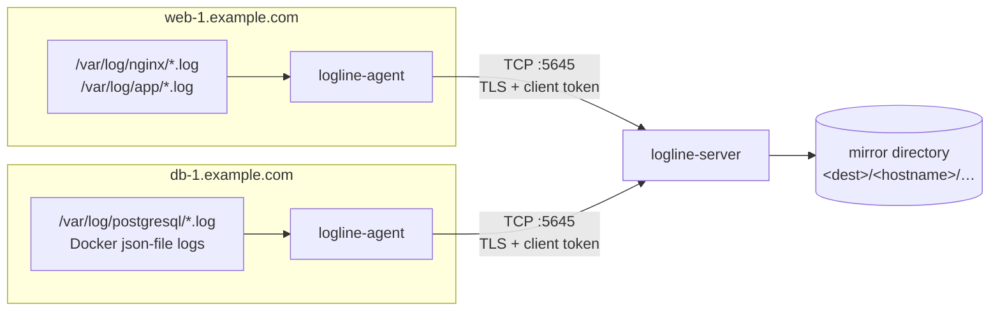
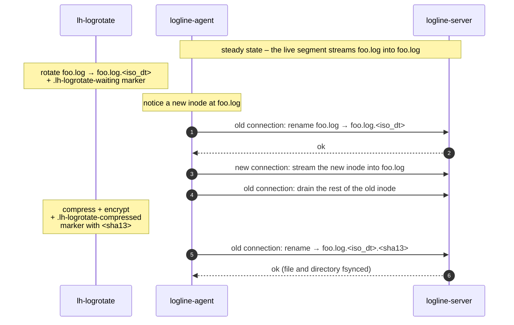
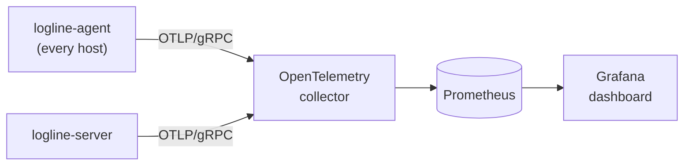

Logline
=======

[](https://github.com/leadhub-code/logline/actions/workflows/python-tests.yml)
[](https://github.com/leadhub-code/logline/actions/workflows/e2e-tests.yml)
[](https://github.com/leadhub-code/logline/actions/workflows/docker-build.yml)
[](LICENSE)

Live synchronization of log files from multiple computers (usually VMs, servers…) to a single place.

(Log file = a regular file that only grows (new content is only appended) and can be rotated.)

Logline consists of two pieces:

- **agent** reads the logs and sends their content to the server via (encrypted) TCP connection
- **server** listens on a TCP port, receives data from agents and manages a mirror of the log files processed by agents



Features
--------

- **Live tailing** – new lines show up on the server within about a second.
- **Rotation-aware** – follows files across rotations and keeps the rotated
  segments on the server under the same names that
  [lh-logrotate](#rotation) gives the archived files; markerless rotations
  (e.g. Docker's `json-file` driver) are handled too.
- **Resumable** – after a reconnect or restart the agent continues from the
  server's current length instead of resending the whole file.
- **Encrypted and authenticated** – optional TLS (Let's Encrypt or self-signed
  certificate) and per-agent client tokens.
- **Compressed transfer** – data chunks are gzipped whenever that makes them
  smaller.
- **Observable** – optional OpenTelemetry metrics and a ready-made
  [Grafana dashboard](grafana/).
- **Simple** – pure Python (3.9+), `asyncio`, a single dependency (PyYAML) plus
  optional OpenTelemetry packages.

Quick start
-----------

The agent and the server are separate Python packages living in the `agent/`
and `server/` directories. Install them straight from Git, for example with
[uv](https://docs.astral.sh/uv/):

```bash
uv tool install "git+https://github.com/leadhub-code/logline#subdirectory=server"
```

```bash
uv tool install "git+https://github.com/leadhub-code/logline#subdirectory=agent"
```

(For the optional metrics support use the `name[otel] @ url` form, e.g.
`"logline-agent[otel] @ git+https://github.com/leadhub-code/logline#subdirectory=agent"`.)

Generate a client token and compute its hash for the server (see
[Authentication](#authentication)):

```bash
openssl rand -hex 32 > client-token
```

```bash
python3 -c 'from hashlib import sha1; print(sha1(open("client-token", "rb").read().strip()).hexdigest())'
```

Run the server on the central machine (the destination directory must already
exist):

```bash
mkdir -p /srv/logline
```

```bash
logline-server --dest /srv/logline --client-token-hash <sha1-hex-from-above>
```

Run the agent on every machine whose logs you want to collect:

```bash
logline-agent --server logs.example.com:5645 --token-file client-token --scan '/var/log/*.log'
```

This minimal setup sends the token and the logs in plaintext. For anything
beyond a trusted network enable TLS: `--tls-cert` and `--tls-key` on the
server, `--tls` (or `--tls-cert <ca.pem>` for a self-signed certificate) on the
agent.

The server image can also be built with Docker (it includes the metrics
support). Its entrypoint is `logline-server`, so options can be passed directly
(or use a config file via the `CONF_FILE` environment variable):

```bash
docker build -t logline-server server
```

```bash
docker run -p 5645:5645 -v /srv/logline:/data logline-server --dest /data --client-token-hash <sha1-hex>
```

How the mirror looks
--------------------

The server stores every file under `<dest>/<hostname>/<mangled-directory>/`,
where `<hostname>` is what `socket.getfqdn()` returns on the agent's machine
and `<mangled-directory>` is the resolved (symlink-free) source directory with
every `/` replaced with `~`. For example:

```
/srv/logline/                                         ← dest
└── web-1.example.com/                                ← agent's hostname
    ├── var~log~nginx/                                ← /var/log/nginx
    │   ├── access.log                                ← live file
    │   ├── access.log.20261105T000000Z.bd0fe0ff5ceeb ← finalized lh-logrotate segment
    │   └── access.log.20261106T000000Z               ← just rotated, still draining
    └── var~lib~docker~containers~3f2a…/
        ├── 3f2a…-json.log                            ← live file
        └── 3f2a…-json.log.orphan                     ← last self-rotated segment (ephemeral)
```

Configuration
-------------

Both programs accept command-line options (see `--help`) and a YAML config file
passed via `--conf` (the server also reads the `CONF_FILE` environment
variable). Relative file paths in a config file (`dest`, `log.file`, TLS files,
`client_token_file`) are resolved relative to the config file itself; the glob
patterns in `scan`, `exclude` and `ephemeral` are not, so make them absolute. Single-value command-line options take precedence over the config
file; list options (`--scan`, `--client-token-hash`) are merged with it.

### Agent

```yaml
server: logs.example.com:5645

tls:
  enabled: true
  # cert: server-ca.pem   # CA bundle or self-signed cert to verify the server with
  #                       # (also enables TLS); without it the system trust store is used

client_token_file: client-token

# Files to follow (Python glob syntax, `**` is recursive).
scan:
  - /var/log/*.log
  - /var/log/nginx/*.log
  - /var/lib/docker/containers/*/*-json.log

exclude:
  - /var/log/*-debug.log

# Skip every matched file whose directory contains one of these files.
exclude_if_file_present:
  - .logline-ignore

# Self-rotating sources without lh-logrotate markers, see below.
ephemeral:
  - /var/lib/docker/containers/*/*-json.log

log:
  file: logline-agent.log
  level: info             # info (default) or debug

metrics:
  enabled: true
  endpoint: http://localhost:4317
```

### Server

```yaml
bind: :5645               # default: all interfaces, port 5645
dest: /srv/logline

tls:
  cert: fullchain.pem
  key: privkey.pem
  # key_password_file: key-password

client_token_hashes:
  - <sha1-hex-of-the-client-token>

reuse_port: false         # see "Scaling the server"

log:
  file: logline-server.log
  level: info

metrics:
  enabled: true
  endpoint: http://localhost:4317
```

Authentication
--------------

Agents authenticate to the server with a shared secret client token. Logline
does not generate this token for you – pick your own random string, for
example with `openssl rand -hex 32`.

Configure it on the **agent** via one of (checked in this order):

- `--token-file <path>` command-line option
- `CLIENT_TOKEN` environment variable
- `client_token` in the agent's config file
- `client_token_file` in the agent's config file (path relative to the config file)

The **server** never stores the raw token, only its SHA-1 hex digest. Compute
it from a file holding the token (surrounding whitespace is ignored, just like
the agent does when it reads a token file):

```bash
python3 -c 'from hashlib import sha1; print(sha1(open("client-token", "rb").read().strip()).hexdigest())'
```

and configure it via `client_token_hashes` (a list) in the server's config
file, or repeated `--client-token-hash` options. Multiple hashes can be
configured at once, so tokens can be issued per agent and rotated or revoked
individually. If a connecting agent's token doesn't match, the server logs
the hash it computed for the rejected token, which is convenient when
provisioning a new agent.

The TCP connection can be encrypted via SSL/TLS – using a certificate for
example from LetsEncrypt.org or a self-signed one. Enable it on both sides: the
server with `tls.cert` + `tls.key`, the agent with `tls.enabled` (and `tls.cert`
when the server's certificate is not trusted by the system).

Rotation
--------

The agent is the sole authority on file identity and rotation; the server only
appends bytes to the file the agent names and renames it when told to. Most
rotations are driven by lh-logrotate, which drops marker files next to the log. The agent reads those markers and
parrots their timestamp and hash, so the mirror ends up with the same names as
the archived files (minus the `.xz.gpg` suffix):



A rotation without any marker is sealed as an *orphan*,
`foo.log.<iso_dt>.orphan`. The wire format and the naming rules are described
in detail in [Protocol.md](Protocol.md).

Ephemeral log sources
---------------------

Some sources rotate on their own, without any lh-logrotate markers — most
notably Docker's `json-file` logging driver
(`/var/lib/docker/containers/<id>/<id>-json.log`), which self-rotates every few
minutes. Each such markerless rotation is sealed server-side as an *orphan*, and
by default every orphan gets a unique timestamped name, so they accumulate
unboundedly per source.

Mark these sources as **ephemeral** in the agent's config file with a list of
glob patterns. They use the same glob syntax and matching as the `scan` and
`exclude` keys (`*` stays within a single path component, symlinks resolve the
same way), so a pattern that selects a file under `scan` selects the same file
here:

```yaml
ephemeral:
  - /var/lib/docker/containers/*/*-json.log
```

A markerless rotation of an ephemeral source is sealed under the fixed name
`<basename>.orphan` (no timestamp). Each rotation overwrites the previous orphan,
so the server keeps at most two files per source — the live file and the last
sealed segment — instead of an ever-growing pile. Marker-based (lh-logrotate)
rotations of an ephemeral source are unaffected.

Scaling the server
------------------

A single server instance is single-threaded. To use more CPU cores you can run
multiple instances listening on the same address by passing the `--reuse-port`
option (which sets the `SO_REUSEPORT` socket option, available on Linux). The
kernel then load-balances incoming connections across all instances. In Docker,
run the instances with `--network=host` so they share the host's network stack.

On Linux all sockets sharing a port via `SO_REUSEPORT` must belong to the same
effective user, which prevents other users from hijacking the port. Be aware,
though, that any process running as the same user on the host can join the
listening group.

Monitoring
----------

With `metrics.enabled: true` (and the `otel` extra installed) both programs
export OpenTelemetry metrics over OTLP/gRPC – to `metrics.endpoint`, the
`OTEL_EXPORTER_OTLP_ENDPOINT` environment variable, or `localhost:4317`. Setting
`OTEL_SDK_DISABLED=true` turns them off. An importable Grafana dashboard and
notes on the expected collector setup live in [grafana/](grafana/).



Development
-----------

The repository has three [uv](https://docs.astral.sh/uv/) projects: `agent`,
`server` and `e2e_tests` (end-to-end tests that run both programs together).

```bash
make check   # ruff + pytest for every component
```

```bash
make test    # tests only
```

```bash
make lint    # ruff only
```

```bash
make image   # build the server container image (uses podman)
```

License
-------

[MIT](LICENSE)
